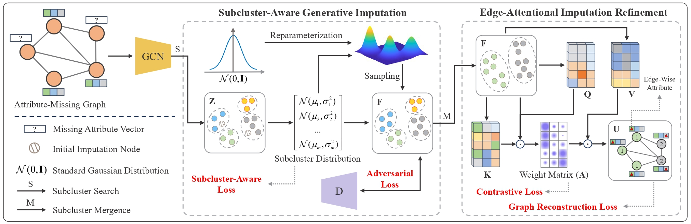

# Clustering-Oriented Generative Attribute Graph Imputation (ACM MM-25)

The code for "Clustering-oriented Generative Imputation with reliable Refinement" (CGIR).



## Run CGIR

```python
Python main.py
```

The proposed CGIR is implemented on Pytorch framework.

The files termed Cora_20.pth and Cora_40.pth in the data folder represent the original cora dataset with a missing rate of 20% and 40%, respectively.

## Citation

```
@inproceedings{CGIR,
  title={Clustering-Oriented Generative Attribute Graph Imputation},
  author={Chen, Mulin and Wang, Bocheng and Zhong, Jiaxin and Miao, Zongcheng and Li, Xuelong},
  booktitle={Proceedings of the ACM International Conference on Multimedia},
  pages={1092--1101},
  year={2025}
}
```

